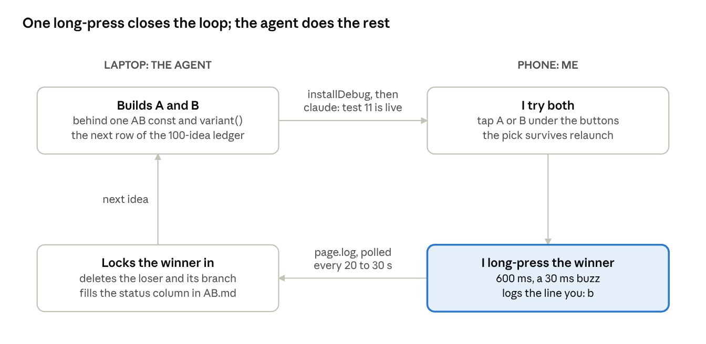

# Push-button A/B testing: tuning a transcriber from the phone

Draft, live version: https://claude.ai/artifact/TWn1iTofaUpuznmCDfU8cW

Oct 22, 2026 · @Jon Borchardt

## The problem: only an ear can say "better"

I settled seven product decisions in one day without reading a line of code: I tried two versions on my phone and long-pressed the one I liked. A coding agent did everything else.

The app is Strudoodle. You hum or beatbox into a phone and it writes a [Strudel](https://strudel.cc) pattern back. Tests cover the transcriber, but no test can say whether a feature feels right in the hand. That verdict needs a person holding the phone, and that person should not have to open a laptop to give it.

## The setup: a log that talks both ways

Strudoodle is one Android WebView running Strudel. It has no IDE: the agent builds with gradle, installs with adb and reads logcat. Everything the page does goes through one `log()` call, which shows on the phone's Log tab and lands in `files/page.log`.

That log is the whole channel between us:

- **Me to the agent:** I type into the box under the log. Each line is logged as `you: …`, and the agent polls the file every 20 to 30 seconds.
- **Agent to me:** it runs `node scripts/say.mjs "…"`, an Android broadcast that shows up at once in the Log tab as `claude: …`.

No server, no chat app, no account. A file on the phone and a broadcast intent are enough. (A file inbox the other way failed: SELinux lets the debug shell read the app's files but not create them.)

## The loop: one test, two buttons, one long-press

The agent and I keep a ledger, `AB.md`: 100 ideas ranked by how much they help "hum it, get a pattern" per line of code. Each row names what A does and what B does. Exactly one row is under test at a time.

On the phone, a row under the Play and Listen buttons shows the two variants. A tap switches between them; the code reads `variant()` wherever they differ. A long-press on one of them is the vote: it writes the same `you: b` line I could have typed, buzzes once, and shows "voted B" in the status line.

The agent never starts the next test before a verdict. When it sees the line, it deletes the losing code, records the verdict, puts the next idea into the `AB` const, reinstalls, and tells me what to try next.

## What one day produced

The first day settled seven rows and dropped three more. The first test went live around 00:50 on 22 October; by that evening test 11 was on the phone.

| # | Idea | Verdict | What actually shipped |
| --- | --- | --- | --- |
| 1 | Count-in before a take | A: no count-in | Recording starts at once |
| 2–4 | Tap tempo, metronome, downbeat from the count-in | Dropped | All three leaned on the count-in that lost |
| 5 | Solo / mute per track | B | Icons: 🔊/🔇 mute, 🎧 solo |
| 6 | Re-record a track in place | B, reshaped | A 🎤 button instead of a long-press on ×; × now asks to confirm |
| 7 | Undo last remove | Skipped | Made moot by the confirm on × |
| 8 | Session survives relaunch | B | Tracks kept in localStorage |
| 9 | Copy pattern to clipboard | B | In the pattern box's corner; selects what it copies |
| 10 | Open in strudel.cc | B | A strudel.cc ↗ link that opens the browser |
| 11 | Waveform strip of the take | Testing | The take drawn under its track, ticks where notes and hits were heard |

Two patterns stand out. A losing test can retire a cluster of ideas that depended on it (rows 2 to 4). And a winner is often B with a twist: I typed a sentence next to my `b`, and the agent built the version I described rather than the one in the ledger.

The long-press itself came out of the loop. Typing `b` on a phone keyboard was the slowest part of a test, so voting moved onto the buttons I was already touching.

## Why it works

It splits the work by what each side is good at. I judge; the agent does every step that is not judgement.

- **The decision is tiny.** Comparing two concrete versions in the hand takes seconds. Reviewing a diff or a design doc takes an evening.
- **The oracle is real use.** I vote on the installed app, on my phone, on my own takes, not on a screenshot or a description.
- **Losers are deleted, not flagged.** After a verdict there is one code path again. Nothing piles up behind feature flags.
- **The ledger keeps the order honest.** Ideas are ranked by value per line of code before any of them is built, so the loop works the list top down instead of chasing whatever came to mind last.
- **I can be away for hours.** The agent polls, or schedules a check for when I said I'd be back, and never starts test N+1 before the verdict on test N.

## Borrowing it

You need four pieces, and none of them is a framework:

1. **A ranked ledger** of ideas, each with an A and a B written down before anything is built.
2. **One switch in the code**, a `variant()` that returns `a` or `b` and is read wherever they differ.
3. **A vote that costs one gesture** in the place you already use the product, landing somewhere the agent can read.
4. **A way for the agent to talk back** in that same place, so you know a new test is live without checking a laptop.

Gotchas we hit:

- `am broadcast --es text …` kept only the first word of a message; a small script now quotes the text for the phone's shell.
- An app launched while the screen is off is a background app in doze: its network is blocked and the sample packs do not load. It looks like a bug and is not.
- Wireless adb's port changes every boot, and multicast discovery found nothing on this PC; a tiny port scanner finds it.
- One test at a time is the rule that matters most. Two live tests make every verdict ambiguous.
